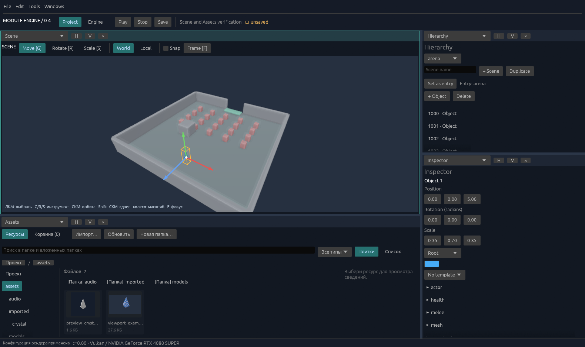

# ModuleEngine 0.4

Модульный движок на Rust с двумя рабочими пространствами. Engine задаёт архитектуру; Project настраивает игру в разрешённых движком границах. Нативный редактор показывает типизированные вложенные графы, реальную 3D-сцену Vulkan и редактируемый Rust/HLSL.

Object и ECS — независимые модели хранения с общими контрактами сцены и команд. Forward/deferred пути исполняют геометрию, освещение, SSAO, ACES/Reinhard, FXAA и кодирование цвета. Custom Rust действительно компилируется; неизвестные визуальному редактору конструкции остаются обычным текстом.

В 0.4 добавлен игровой маршрут: сохраняемые сцены и связанные шаблоны, общий граф исполняемых систем, ввод/столкновения/бой/события/звук, статические glTF/GLB и текстурированные материалы, постоянное состояние Rust Custom и отдельный Windows Player. Пример содержит две арены, 20 монстров и босса. [Назначение и устройство этапа](docs/next-stage.md), [редактор игры](docs/editor-game.md), [запуск и экспорт Player](docs/player.md).

~~~powershell
.\outputs\ModuleEngine.exe game-project.json
.\outputs\ModuleEngine.exe --play game-project.json
.\outputs\ModuleEngine.exe --export-game game-project.json outputs\my-game
~~~

[Итог этапа 0.4: проверки, производительность и оставшиеся ограничения](docs/release-v04.md).

[Функциональный аудит и исправления стабильности](docs/stability-audit.md): проверяемые сценарии, обработка отказов, Git-история и полный повтор через `verify.ps1`.

[Схемы компонентов и общий реестр](docs/component-schemas.md): поля Inspector, defaults, ссылки, зависимости и установка исходного модуля. [Хранение игрового мира и время жизни объектов](docs/ecs-world.md). [Ход изменения архитектуры и проверенные границы](docs/modular-runtime-progress.md).

Ближний бой теперь показывает область прицеливания, цели, взмах, вспышку попадания и число урона в Play и Player. [Устройство визуала атаки](docs/combat-feedback.md).

Редактор имеет меню **File / Edit / Tools / Windows**: новые проекты на текущем Engine, нативные диалоги, Recent, Save As с ресурсами, защита несохранённых изменений, проверка и сборка Player, поиск окон и личные раскладки. Начните с **File → New Project → Empty scene** или **Two arenas example**. [Рабочий процесс и назначение команд](docs/editor-workflow.md), [результат UI-этапа и проверки](docs/release-ui.md).

Авторская работа теперь разделена на **Scene / Hierarchy / Inspector / Assets**, с общим выбором объекта. В Scene доступны выбор геометрии кликом, перемещение/вращение/масштаб ручками, World/Local и Snap. Assets даёт папки, поиск, импорт, превью, перетаскивание, постоянные ID, переименование/перенос и управляемое удаление с корзиной. **Game** запускает отдельную Play-копию. [Как пользоваться Scene и Assets](docs/scene-assets.md), [устройство ресурсов и файловой истории](docs/asset-workspace-api.md).

## Запуск

Основная Windows-поставка запускается из E:\ModuleEngine:

~~~powershell
.\outputs\ModuleEngine.exe
~~~

Для сборки и редактируемого Rust Custom нужны Rust/Cargo 1.99.0, MSVC C++ build tools и Windows SDK; для компиляции HLSL — DXC. GPU требует совместимый Vulkan 1.3 адаптер/драйвер. Экспортированный Player использует готовые workers и SPIR-V и не требует Rust/Cargo/DXC. Точные требования — в [GPU/HLSL](docs/gpu-hlsl.md).

~~~powershell
.\scripts\bootstrap.ps1 -Json
cargo run --locked -p module-engine-editor
~~~

Doctor проверяет инструменты без загрузок. Явный .\scripts\bootstrap.ps1 -Restore восстанавливает закреплённые Rust/DXC и Cargo-зависимости локально в проекте. После создания локального Rust подключите . .\.tools\env.ps1 в новой PowerShell-сессии. MSVC/SDK и драйвер остаются требованиями хоста; холодная установка Rust отдельно не проверена.

Без аргумента редактор предпочитает game-project.json в выбранном пакете/папке; если его нет, открывает project.json. Готовая авторская поставка 0.4 поэтому открывает игровой пример. Прежний project.json с кубами и полом доступен по явному пути. File → New Project создаёт новый JSON и ресурсы на текущем Engine в выбранной отдельной папке. В runtime-пакете Player.exe без аргументов открывает игру из player.json. CLI редактора принимает путь и --profile full|team.

## Engine и Project

| Поставка | Доступ |
| --- | --- |
| Full, полный совместимый source manifest | Архитектура Engine, исходники, настройки и поля Project. |
| Full, неполные/несовместимые исходники | Project и диагностика; Engine недоступен. |
| Team | Project и разрешённый gameplay Update Rust. Engine всегда недоступен, даже рядом с полными исходниками. |

.module-engine-package.json проверяет версию, обязательные Cargo/native Rust/HLSL файлы и inventory активных модулей. Изменение исходного Rust отмечается как modified и сохраняет авторский доступ. Отсутствие компилятора диагностируется отдельно и не скрывает Engine. Native world/renderer/UI требуют пересборки; hot apply касается графов, HLSL и Custom Rust.

Engine объявляет параметры, диапазоны и готовые варианты. Project меняет разрешённые значения и условия выбора существующих вариантов; не добавляет/переставляет проходы. В демо доступны exposure, ACES/Reinhard и FXAA/off. Условия сравнивают параметр или время; первое совпавшее правило группы выбирает вариант.

Модули предоставляют поля Number/Boolean/Enum/Text. Общие настройки видны в Project Settings; Object/Component поля — только у действительных участников активных модулей. Пример прежнего project.json: game.motion объекта 1 предоставляет game.motion.speed для compiled controller. Новый игровой маршрут использует компоненты авторских сцен и metadata подключённых SystemDescriptor; scalar demo controller не управляет его актором. Отключённые авторские поля сохраняются для восстановления, но не передаются runtime и новой Team/Player-поставке.

Scene и Inspector сохраняют Transform/Color, компоненты, ссылки и шаблоны в авторском проекте. Game использует отдельную Play-копию; авторские изменения доступны после Stop. Старые 3D Viewport и Object Tree/Components находятся в Engine и показывают его демонстрационный runtime. Импорт моделей/текстур доступен в Assets. Networking есть как schema test fixture; multiplayer, DLAA и SMAA не реализованы.

## Области редактора

Engine и Project имеют отдельные личные раскладки. В заголовке области выбирается редактор. H делит область на две рядом, V — сверху/снизу; разделитель перетаскивается, × закрывает область и объединяет с соседней. Full может смешивать доступные редакторы в обоих пространствах.

Меню Windows активирует существующую область выбранного типа в текущем пространстве либо добавляет её рядом с активной. Здесь также доступны Save Layout / Load Saved Layout / Reset Layout. File и Tools объединяют открытие, сохранение, импорт, диагностику и экспорт; операции показывают ход работы и ошибки. Save As в другую папку сохраняет все авторские данные и ресурсы; подтверждённая замена существующего JSON создаёт резервные копии метаданных, а конфликты ресурсов отклоняются. Связь с установленным Engine хранится в отдельном файле рядом с JSON. Для переноса самого движка используйте отдельный Full/Team экспорт. Отмена или ошибка Open/New сохраняет текущие правки; проверка/экспорт без сохранения использует JSON на диске, оставляя правки открытыми. [Подробности](docs/editor-workflow.md).

Scene, Hierarchy, Inspector и Assets работают с авторским проектом; Game показывает игровую копию. Каждая область Scene имеет собственную свободную камеру. Legacy Preview в Engine имеет независимую камеру при общем демонстрационном Runtime. Gameplay Systems задаёт граф исполнения автора Engine. Игровая симуляция имеет fixed tick 1/60 независимо от кадров UI. Раскладки хранятся отдельно в .user/<full|team>/<engine|project>.json; позиции gameplay canvas — в .user/full/game-systems-positions.json.

| Действие | Управление |
| --- | --- |
| Добавить модуль/проход | **+ Узел** в нужном графе или **Module Library** с поиском; строка «Добавление в» показывает получателя. |
| Переместить узел | Перетащить заголовок. |
| Связь | Выход справа → совместимый вход слева. |
| Удалить связь / открыть вложенный граф | Двойной щелчок по линии / заголовку. |
| Граф: pan/zoom | Правая/средняя кнопка; Ctrl + колесо. |
| Legacy 3D Preview: камера | Левая кнопка на изображении; колесо. |
| Scene: инструменты | G/R/S — перемещение/вращение/масштаб; Escape отменяет текущий жест. |
| Scene: камера | Средняя кнопка — вращение; Shift + средняя — сдвиг; колесо — приближение; F — выбранный объект. |
| Game и Player | WASD — движение, ЛКМ — удар к курсору, R — Restart. |
| Создать / открыть / сохранить / Save As | Ctrl+N / Ctrl+O / Ctrl+S / Ctrl+Shift+S. |
| Undo/redo | Edit / History, Ctrl+Z / Ctrl+Y / Ctrl+Shift+Z вне текстового поля. |
| Отменить незавершённую связь | Esc. |

В Engine откройте GPU renderer. «Заменить на редактируемый Custom HLSL» копирует проход в проект; «Применить HLSL» активирует проверенного кандидата. В Custom Rust доступны текст и визуальные правки известных фрагментов; «Применить Rust» компилирует в фоне.

Удалённые FXAA/AO можно вернуть из библиотеки и соединить заново. FXAA подключается между тонмаппером и кодированием; AO использует HDR-цвет, нормали и глубину. Настройки новых проходов используют их реальные ID, несовместимое соединение сохраняет прежнюю связь. [Пошаговая сборка графа и диагностика производительности](docs/editor-workflow.md#сборка-gpu-графа-и-возврат-удалённых-проходов).

Ошибка сохраняет текст, диагностику и последнюю рабочую версию. Совместимая замена renderer сохраняет мир/время; смена мира сбрасывает симуляцию. JSON File черновик применяется при уходе, синтаксическая ошибка оставляет редактор открытым. Team проверяет frozen blueprint при загрузке, сохранении и применении документа. History хранит документ, checkpoints, diff и merge с явными конфликтами; не перематывает симуляцию.

## CLI и экспорт

~~~powershell
.\outputs\ModuleEngine.exe --check project.json
.\outputs\ModuleEngine.exe --render project.json outputs/scene.png
.\outputs\ModuleEngine.exe --export project.json exports/my-engine
.\outputs\ModuleEngine.exe --export-team project.json exports/my-game
.\outputs\ModuleEngine.exe --capabilities project.json
~~~

--check компилирует подключённый Rust и проверяет legacy маршрут, а при наличии game создаёт настоящий GameHost и проверяет авторские сцены/исполнение. --render выполняет 90 шагов по 1/60 с ограниченным Rust tick и пишет PNG 960×640; для game используется та же игровая копия с нейтральным вводом, без HUD. Исходный JSON не заменяется изображением. --game-check и --player-benchmark отдельно проверяют игровой маршрут и реальное окно; см. [проверки игры](docs/game-verification.md) и [Player](docs/player.md).

Full экспорт содержит весь source workspace, граф/Rust/HLSL, docs/examples, assets/includes, DXC/DLL/лицензии, scripts, Cargo.lock, toolchain manifest и свежий source manifest. Он отдельно собирается из исходников.

Team экспорт содержит готовый ModuleEngine.exe, project.json, frozen blueprint/exposure/Engine Rust, разрешённый gameplay, assets/backend/DXC и .sdk с Core source/lock для compiled Custom. Native editor/Vulkan workspace отсутствует. Запуск .\ModuleEngine.exe или .\run.ps1; Restore использует .sdk/Cargo.toml и local tools/cache. Профиль — политика авторства, не security sandbox.

Экспорты редактора Full/Team требуют Full и полный source inventory. Отдельный --export-game создаёт runtime Player с заранее собранной логикой и шейдерами. Назначение — новый/пустой каталог; .work/target/.user/.tools не упаковываются. Исходники/includes берутся из выбранного пакета, registered assets — относительно открытого JSON. [Поставки](docs/distribution.md) и [Player](docs/player.md) описывают разные экспорты.

## Проверка

~~~powershell
cargo test --locked --workspace
cargo clippy --locked --workspace --all-targets -- -D warnings
cargo run --locked -p module-engine-editor -- --self-check outputs/verification-v03/cpu
cargo run --locked -p module-engine-editor -- --integration-check outputs/verification-v03/integration
cargo run --locked -p module-engine-editor -- --settings-check outputs/verification-v03/settings
~~~

Integration проверяет Vulkan forward/deferred, Custom compute/vertex/fragment, Rust-команды, invalid candidates, history/merge. Settings-check проверяет поля, архивы, ranges, variants, gameplay Rust и запрет архитектурных изменений. Для GPU-проверок нужны адаптер и Rust/DXC.

В 0.3 на RTX 4080 SUPER проверены равенство Object/ECS snapshots/GPU, реальное движение от game.motion.speed, влияние exposure/вариантов на пиксели и транзакционный отказ значения вне range. Full/Team проверки подтвердили modified source, отсутствие native файла/компилятора, forced Full отказ у Team и blueprint tamper отказ. Прошли 85 workspace тестов: core 21, custom 15, editor 29, project 9, script 3, GPU 8; строгие Clippy и rustdoc с -D warnings чистые. Full/Team экспорты созданы со своим manifest без ручного sealing и перенесены в отдельные каталоги. Relocated Team worker прочитал game asset относительно пакета и отрендерил 90 шагов: 171723 пикселя геометрии. Нативные окна Project и Engine осмотрены. Финальные отчёты — outputs/verification-v03. В новом Team каталоге Restore скачал 13 закреплённых зависимостей в собственный кеш; затем Team executable с очищенными CARGO_HOME/CARGO_TARGET_DIR скомпилировал Custom SDK и отрендерил сцену. Проверка использовала установленный Rust/MSVC и драйвер; холодная установка этих инструментов не проверялась.

GPU использует synchronous offscreen readback для egui с повторным использованием ресурсов и cached memory; swapchain/кадры в полёте отсутствуют. Worker остаётся запущенным, а явно объявленное JSON-состояние сохраняется транзакционно между кадрами и при совместимом hot apply. Он имеет обычные права ОС. Визуальный Rust ограничен известными выражениями/командами. Скелетная анимация, прозрачность/полный PBR, dynamic rigid bodies, игровые сохранения, GPU buffer/geometry-порты, virtual geometry, live coediting и dynamic binary plugins ещё не реализованы. Производительность GameHost и настоящего Player window измеряется раздельно; результаты предыдущего 0.3 выше не являются результатами нового игрового этапа.

## Документация

| Тема | Документ |
| --- | --- |
| Цель игрового этапа и принятый объём | [next-stage](docs/next-stage.md), [решения](docs/decisions.md), [дальнейшие вопросы](docs/questions.md) |
| Общая архитектура и JSON | [architecture](docs/architecture.md), [graph-format](docs/graph-format.md) |
| Исполняемые модули и игровые правила | [module-execution](docs/module-execution.md), [gameplay](docs/gameplay.md), [пакеты игровых правил](docs/optional-gameplay.md) |
| Меню, файлы, окна и рабочий процесс | [editor-workflow](docs/editor-workflow.md) |
| Сцены, шаблоны и работа в редакторе | [scenes](docs/scenes.md), [editor-game](docs/editor-game.md) |
| Контент и GPU | [content](docs/content.md), [gpu-hlsl](docs/gpu-hlsl.md) |
| Rust, состояние и hot apply | [custom-rust](docs/custom-rust.md), [custom-state](docs/custom-state.md) |
| Настройки, расширения, история | [settings](docs/settings.md), [extending](docs/extending.md), [history-assets](docs/history-assets.md) |
| Поставки редактора и отдельная игра | [distribution](docs/distribution.md), [player](docs/player.md) |
| Проверки и границы измерений | [game-verification](docs/game-verification.md) |

