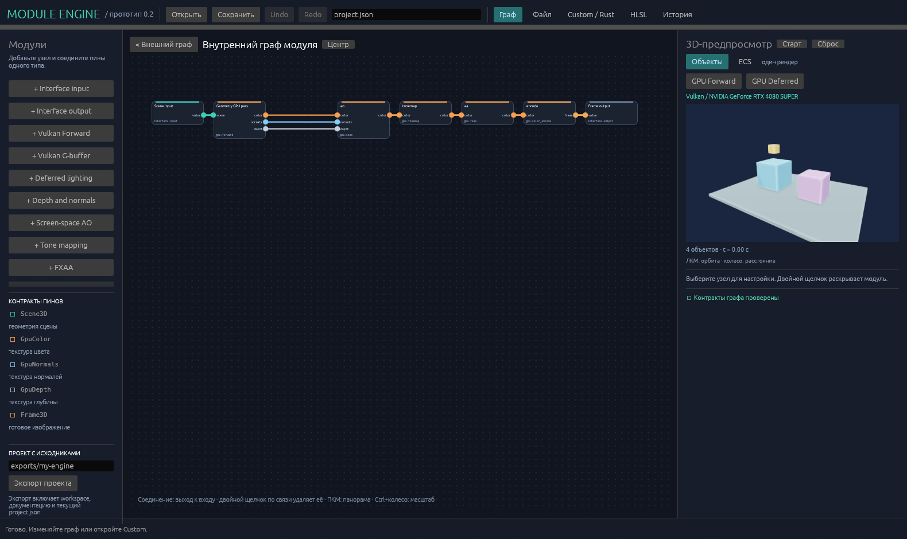

# Vulkan and Custom HLSL

[English](gpu-hlsl.md) | [Русский](ru/gpu-hlsl.md) | [Documentation](README.md)

The renderer executes raster and compute passes on Vulkan. In the editor, DXC compiles HLSL to SPIR-V; the renderer creates pipelines, images and barriers. Player export precompiles shaders. The two built-in routes differ in their actual sequence of GPU work.

| Pass | Input/result |
| --- | --- |
| gpu.forward | Scene3D → HDR color, world normals, linear camera depth. |
| gpu.gbuffer | Scene3D → linear albedo, normals, depth. |
| gpu.deferred | G-buffer → HDR lighting. |
| gpu.depth_normal | Scene3D → normals/depth. |
| gpu.ssao | HDR + normals/depth → HDR with ambient occlusion. |
| gpu.tonemap | HDR → linear LDR; ACES/Reinhard modes, exposure. |
| gpu.fxaa | Linear LDR → Linear LDR, spatial AA of the current frame. |
| gpu.color_encode | Linear LDR → rgba8unorm/srgb_display. |
| gpu.custom | Custom raster/compute pass with params.manifest and source_id. |

## Editing in Engine

Select GPU Forward or GPU Deferred, then double-click to open the renderer's nested graph. Select a pass: the inspector shows its parameters and resource contracts. Replace with editable Custom HLSL copies the shipped shader text and manifest into the project, preserving the pass ID and external connections.

Edit the text in the HLSL tab and press Apply HLSL. An invalid candidate remains in the project with diagnostics; the previous working configuration is preserved. Changes to resources, bindings and entry points must agree with the manifest.

Standalone templates are in assets/gpu/custom_compute.hlsl, custom_raster.hlsl and custom_fullscreen.hlsl. They are available as ordinary sources.

## Pass manifest

Example params for an HDR compute filter:

~~~json
{
  "source_id": "my_filter",
  "gain": 1.0,
  "manifest": {
    "stage": "compute",
    "entry": "main",
    "workgroup": [8, 8, 1],
    "parameters": ["gain"],
    "inputs": [{
      "name": "color", "format": "rgba32float",
      "semantic": "hdr_linear", "extent": "viewport",
      "samples": 1, "access": "sampled_read"
    }],
    "outputs": [{
      "name": "color", "format": "rgba32float",
      "semantic": "hdr_linear", "extent": "viewport",
      "samples": 1, "access": "storage_write"
    }]
  }
}
~~~

source_id points to shader_sources. stage is compute or raster. For raster, raster_mode selects scene/fullscreen; entry specifies the fragment entry, and vertex_entry an optional user vertex entry. Scene raster accepts exactly one Scene3D; fullscreen/compute do not accept it.

ResourceSpec contains name, format, semantic, extent, samples, access. Image formats: rgba32float, r32float, rgba8unorm. Built-in pass semantics: hdr_linear, ldr_linear, albedo_linear, world_normals, camera_linear_depth, srgb_display; a scene has format:scene/semantic:scene3d. Input images use sampled_read, raster outputs color_write, compute outputs storage_write. Compatibility requires matching format, semantic, extent and samples.

Unknown manifest/ResourceSpec fields are rejected. Pass params allow only declared parameters, enabled:bool and Custom's supporting source_id/manifest. Up to 16 scalar parameters; parameters order determines value placement in push constants. Built-in tonemap separately supports a string mode.

## HLSL ABI

Descriptor set 0: input bindings first in inputs order, then compute output bindings in outputs order. Texture2D<float> and Texture2D<float4> are read through Load; sampler/buffer bindings are not yet present in this manifest. A storage image requires an exact vk::image_format attribute, for example rgba32f. Reflection checks compiled image types, bindings, storage format and LocalSize.

Push constants are 128 bytes: four camera float4s and four parameter float4s. Use the shipped [[vk::push_constant]] ConstantBuffer<Config> declaration; parameters occupy values, for example the first scalar is values[0].x.

Compute workgroup must match numthreads in SPIR-V, z=1, and the product of dimensions must be from 1 to 256. Check image bounds before Store. Scene vertex ABI: position float3, normal float3, color float4, ids float2, UV float2, atlasRect float4, locations 0–5, stride 72 bytes. The first 48 bytes preserve the previous data layout: an existing Custom shader can use only locations 0–3. An example vertex/fragment pair is in custom_raster.hlsl.

The optional manifest field `scene_materials: true` is allowed only for scene raster. It adds a sampled image binding after explicitly listed image inputs: the base-color atlas from `SceneSnapshot` materials. In Forward/G-buffer this is binding 0. UV is at location 4 and atlasRect at location 5; rect contains the texture's origin and size in pixels. The fragment shader carries UV with perspective interpolation and rect with `nointerpolation`, then uses `Texture2D.Load`. Built-in shaders explicitly decode sRGB to linear color. Converting a built-in pass to Custom preserves this manifest and material ABI. Depth/normal and ordinary Custom receive no atlas without explicit opt-in. Import details: [content.md](content.md).

Inline HLSL searches for literal #include in assets/gpu of the selected package, then at that package's root. A nested quoted include first searches the containing file's directory; an angle include uses assets/gpu→root. JSON from a separate Full/Team package uses its marker/resource root. Standalone JSON without a marker does not make its directory a new compiler root; source_id is not a path. Export gathers these dependencies recursively. Resolved include contents are read before pipeline selection and included in the fingerprint: changing a header invalidates the compile/pipeline cache even when inline text is unchanged. This was verified by changes in real GPU pixels. A macro in place of an include name is rejected during dependency collection so export cannot lose unknown files.

Ready ACES/Reinhard and FXAA/off can be exposed to the Project author as allowed variants; Team does not change the graph/HLSL. DLAA/SMAA are not yet available.

## Precompiled Player and caches

`precompile_graph_at(graph, sources, source_root, destination)` compiles and validates every stage of the selected graph, including vertex, and writes `destination/.spirv`. When `.spirv` is present, the renderer uses only these artifacts: DXC is not launched and there is no fallback to authoring tools. A missing/corrupt shader produces diagnostics and requires re-export. Include files remain in the package because their contents are checked against the same fingerprint. For other allowed graphs, the exporter calls precompile separately into the same directory.

In the editor, the persistent `.work/shader-cache` reuses SPIR-V by source, entry/profile and include-closure contents. A complete artifact is published by renaming a temporary file; an unfinished result must not be read by a concurrent compiler.

Root HLSL text uses the same shader identity with LF, CRLF or mixed LF/CRLF line endings. Both the direct source key and the root-text part of its dependency fingerprint canonicalize CRLF to LF; LF text keeps its previous key. Compilation and authored files retain their original bytes. Lone CR, other source changes, entry/profile and the resolved include paths still affect identity; included files contribute their exact bytes, including their line endings. This prevents an exporter and a separately compiled Player from disagreeing solely because their embedded root text has different Windows line endings. The hash is an internal cache key, not a stable external ABI.

An older self-contained Player package keeps its own executable and pinned artifacts unchanged. If a rebuilt runtime expects a different key from an older sealed package, re-export it with a matching current Editor/Player pair; do not rename `.spirv` files or relax package pins. A Team installation carrying an older selected Player variant needs a new supported Team delivery built from matching Full sources. Missing artifacts still fail without invoking DXC or falling back to authoring tools.

The backend retains pass images and the vertex buffer between frames with the same configuration/size; explicit CPU rendering also reuses its readback buffer. The GPU material atlas is uploaded when the decoded texture set changes and is reused. Native presentation returns a GPU lease without CPU RGBA pixels. Explicit CPU rendering with `set_detailed_stats(false)` reads only RGBA8 without depth, normals or color-ID reads. Ownership/coverage counts are not measured in this mode; zero does not mean an invisible scene. Submitted counts remain available.

Resource identity includes pass and output IDs, not just the pipeline set: removing AO and adding an identical pass with another ID requires a new image set. Otherwise a reused `ao.color` does not match the new `pass_id.color`. The GPU plan is checked separately from the image cache; settings contracts are checked against metadata without rereading shaders. For an unchanged frame, the plan is reused and external includes are checked at 250 ms intervals; explicit preparation always reads current includes.

An invalid external include preserves the previous working GPU plan and returns diagnostics; the window retains the last successful frame. Repeated frames use the saved error, and dependency bytes are checked after the interval. An unchanged failing set does not launch DXC again; fixing or restoring a file allows the next attempt without editing inline HLSL. The same dependency monitoring allows retrying rejected background Game/Scene preparation. Explicit `prepare` makes a fresh attempt regardless of this limit.

Temporary HLSL/SPIR-V files are deleted even when compilation fails. Dependency revision is rechecked before SPIR-V publication; saving an include during compilation rejects the stale result. The same pass fingerprint is checked before adding a new pipeline so mixed stages cannot be recorded under the previous key.

In the explicit CPU/diagnostic route, the readback buffer prefers `HOST_VISIBLE | HOST_COHERENT | HOST_CACHED` memory. Simply taking the first host-visible memory on a discrete GPU may yield a CPU BAR mapping that is slow to read. If a cached coherent type is unavailable, the backend uses the previous compatible host-visible coherent type. The transfer→host barrier and queue completion remain.

The renderer is measured separately with `cargo run --locked --release -p module-engine-vulkan --example gpu_benchmark`: 20 imported textured models, the complete standard Forward/SSAO/tonemap/FXAA/encoding chain, 1920×1080, 10 warm-up frames and 120 measured frames. On RTX 4080 SUPER after the readback-memory fix, the mean was 3.11 ms, p95 3.98 ms. This is a diagnostic renderer measurement with CPU readback, without game subsystems or egui output; a separate complete measurement corresponds to the finished Player criterion. JSON is written to `.work/gpu-benchmark.json`.

## Native GPU presentation

The normal native Vulkan viewport publishes an opaque GPU frame lease instead of CPU pixels. Windows bridges the separate Vulkan producer to WGPU/DX12 through shared D3D12 resources; Linux bridges separate Vulkan devices through dedicated OPAQUE_FD memory and requires exact device and driver UUIDs. The GUI bridge copies and premultiplies RGBA8 on the GPU into its own native `Rgba8Unorm` texture, preserving the byte rounding of the previous egui conversion without sRGB decoding. Normal presentation performs no pixel readback to CPU and no CPU texture upload. Unsupported or failed interop reports an error and preserves the last good image; it does not silently select CPU transfer.

The native producer admits at most one GPU submission at a time, with four leased output slots. `render_presented` returns `RenderSubmission::Pending(ticket)` after admission; `poll_presented(ticket)` checks completion without waiting and publishes that exact request once. `Busy` admits no work. `Ready(Frame)` supports immediate CPU/software output. Until completion, the previous image, identity, camera and provenance remain current; pending work is not a fresh frame. Scene uploads, atlas images, command resources and pipelines remain owned until their GPU use completes. The GUI separately retains each published lease until actual consumer GPU completion. Dropping a CPU reference or skipping a minimized surface does not complete either side. Explicit CPU/software rendering, diagnostic Glow and PNG/capture retain CPU pixels and may synchronously wait for readback; a conflicting CPU render is rejected while native producer work is pending. There is no game-renderer swapchain or multi-submission producer pipeline.

A valid graph/HLSL candidate may compile and warm caches while a request is pending without selecting the candidate for that request. In-flight commands pin every referenced pipeline/layout and their scene/atlas/extent resources until completion; invalid candidates preserve that request and the accepted wrapper. Submitted and completed GPU-frame counters are distinct.

Cancellation discards publication without waiting or freeing busy GPU resources. Reaping cancelled work may be deferred until the next submission or backend destruction; absence of publication does not permit early reuse. Dropping a renderer transfers unfinished producer work to an owned retirement job; only that background job may wait up to 30 seconds for its own fence. Application shutdown joins these jobs after renderer owners have stopped. `finish_gpu_retirements` reports consumer retirement plus nested `producer` registered/joined/completed/unconfirmed/failed counts. A timeout, device error, panic or failed retirement-thread start preserves unconfirmed resources and their device pin instead of reusing potentially busy memory; it is reported as an error, not successful completion. Linux consumer ownership-release failure retains its existing quarantine behavior. Historical successful or synthetic failure checks do not certify new async sources or real hardware loss.

New async sources require separately bound checks and an independent conclusion in the [async report](gpu-async-20261018.md); passing individual current gates does not establish no regression or final acceptance. The [historical GPU report](gpu-presentation-20261018.md) retains Windows source15/Linux source11 results and earlier failures, including the cold gate open at that time. The [18 October continuation](p0-continuation-20261018.md) separately records the later normal cold PASS 40.906/39.9128549 s, Windows22/16 and WSL Linux23/16 and scoped native/package/lifecycle checks for its own sources. These snapshots do not verify the new async implementation or certify hardware Linux, real device loss or physical scanout.

## Limitations and requirements

Full source validation requires `crates/render-vulkan/src/retirement.rs`. A Full package omitting that module from its source inventory must be rejected before enabling Engine authoring.

Requires Vulkan 1.3, dynamicRendering, a graphics+compute queue, host-visible coherent memory and device-local images. RGBA32_SFLOAT/R32_SFLOAT/RGBA8_UNORM formats must support the color attachment/sample/storage/transfer operations in use; D32_SFLOAT must support depth attachment/transfer src. Presence of vulkan-1.dll does not prove adapter capabilities: actual backend creation checks them.

Buffer/Image receive an RAII owner immediately after the first Vulkan handle is created. Failure in memory selection/allocation, binding or image view creation releases already created parts. The native regression injects failures at intermediate stages, checks handle/device-memory balance and a subsequent successful GPU frame; it does not require deliberately exhausting video memory.

Viewport images have one layer, samples=1; maximum 4096 on each axis and 4 million pixels. MSAA/resolve and temporal AA are deferred. There is no game-renderer swapchain. Normal native output uses shared GPU images; explicit CPU/diagnostic output reads pixels synchronously.

Clear/copy commands address pass_id.output_name and execute after the producer in submission order. An invalid resource, incompatible copy or write after the first consumer is rejected. A portable Rust enabled override takes priority over params.enabled; disabling is allowed only with a compatible single-image bypass.

For built-in geometry, the renderer reads visible IDs and measures ownership. An arbitrary custom scene shader has submitted triangles and coverage available; zero ownership counts mean this measurement is absent, not proof that visible geometry is absent.
