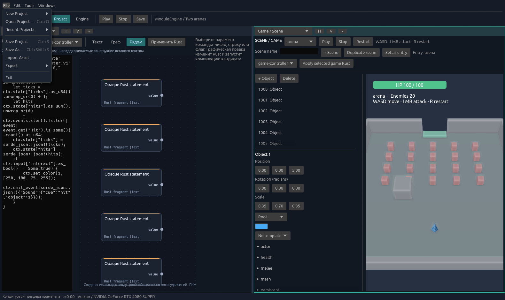
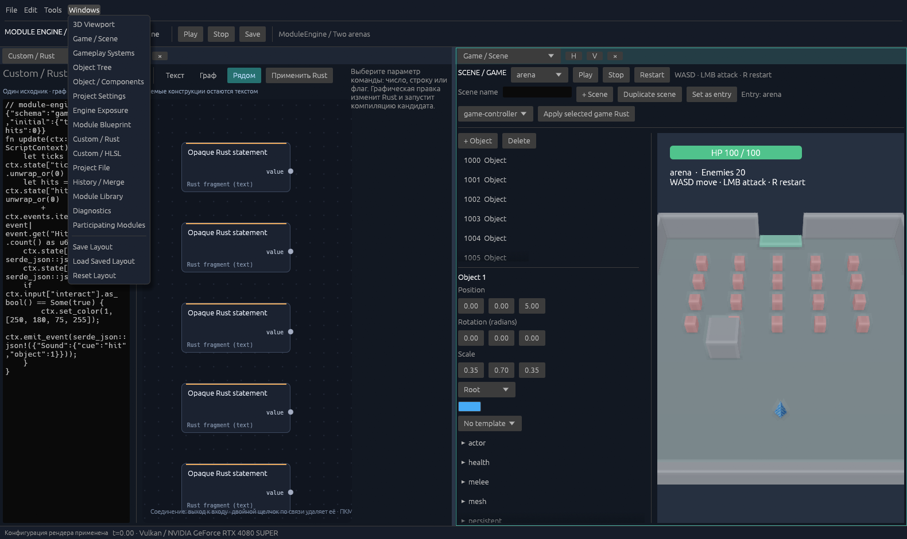

# UI stage: menus and project workflow

[English](release-ui.md) | [Русский](ru/release-ui.md) | [Documentation](README.md)

This stage combines existing engine capabilities into an editor workflow: create a game, open a file, import an asset, save a copy, and build Player. Engine architecture and the authored game remain separate.

## Launch

From `E:\ModuleEngine`:

~~~powershell
.\outputs\ModuleEngine.exe
.\outputs\ModuleEngine.exe game-project.json
~~~

The guide describing commands and the sequence of actions is [editor-workflow.md](editor-workflow.md). Working with objects and prefabs is covered in [editor-game.md](editor-game.md).

## What is implemented

| Plan area | Result |
| --- | --- |
| File | Two new-project templates using the current Engine, Open, Recent, Save / Save As, import, Full / Team / Player export, and exit. |
| Edit | Undo / Redo, History / Merge, and keyboard shortcuts; text Undo remains with the text field. |
| Tools | Project validation, Windows Player build, Diagnostics, Project Settings, and the latest operation report. |
| Windows | Activate an open area of the selected type or add one next to the active area; save, restore, and reset the personal layout. |
| Work protection | Save / Don't Save / Cancel before switching, exiting, validating, or exporting; cancelled/failed Open and New preserve working edits. |
| Background operations | Native dialogs, copying, import, and builds run outside the UI thread; errors and CLI logs are accessible from the report. |

File in the native editor:

Windows in the native editor:

Save As transfers authored data, prefabs, disabled fields, and the entire `assets/` library with declared dependencies. Confirmed JSON replacement retains exact metadata backups; conflicting assets are not overwritten. The new JSON receives its own binding to the installed Engine.

The JSON folder determines paths for game models, textures, and audio, and the Rust Custom working directory. The installed Engine supplies the backend, DXC, shader includes, and SDK/source code for compilation. Team retains a frozen architecture. A separate Full source export is available for moving the engine itself.

## Verification

**164 unit tests**, a separate workspace doc-test run, strict Clippy, and a Rustdoc build with `-D warnings` passed. Results are in `.work/editor-ui-final-units.log`, `.work/editor-ui-doctests.log`, `.work/editor-ui-clippy.log`, and `.work/editor-ui-rustdoc.log`. The count of 164 refers only to unit tests.

`outputs/editor-ui-verification/workflow-report.json` contains `passed: true`. Verification performed actual **File / Edit / Tools / Windows** menu clicks, created both templates while retaining Engine, imported a model, and made an authored copy. The copy preserved the source document and an unused asset; the source JSON did not change. The Vulkan frame with the imported model differed from the empty frame by **3624 pixels**. The exported Player's reference frame matched the authored copy's frame pixel for pixel. The Windows check confirmed reuse of an area in the current workspace.

Separate native application screenshots showed File, Edit, Tools, and Windows open; File and Windows are shown above. File/folder selection in the system dialog is not automated: actual COM factories, Unicode paths, and file-service cancellation branches were checked. This is not manual verification of the entire interactive picker path.

The ready-made `outputs/ModuleEngine.exe` and the `outputs/source-project-v04`, `outputs/team-build-v04`, and `outputs/game-player-v04` deliveries were updated. Previous files are retained in `outputs/update-backup-v04-ui-20261014-223230`.

| Delivery | Result verification |
| --- | --- |
| Full source | `--capabilities` confirms the full inventory and available Engine; `--check` validates the exported game project. |
| Team | Engine remains unavailable; the full `--editor-ui-check` was repeated, including both templates, Save As, SDK compilation, all four menus, and Player frame matching. Report: `outputs/editor-ui-verification/team/workflow-report.json`. |
| Windows Player | Native Player with the imported model was launched with PATH containing only Windows/System32 and with no DXC. The ready-made ARPG Player passed `--game-check` with precompiled logic: `outputs/editor-ui-verification/canonical-player/game-report.json`. Completion is checked on an authored copy with increased hero health; this checks mechanics rather than game difficulty. |

The ready-made editor, Team editor, and Player hashes match. Delivery checks are collected in `outputs/editor-ui-verification/delivery-report.json`. The root game `game-project.json` remained unchanged. The user layout was retained.

Commands to repeat verification:

~~~powershell
cargo test --locked --workspace --lib --bins
cargo test --locked --workspace --doc
cargo clippy --locked --workspace --all-targets -- -D warnings
$env:RUSTDOCFLAGS='-D warnings'
cargo doc --locked --workspace --no-deps
.\outputs\ModuleEngine.exe --editor-ui-check game-project.json outputs\editor-ui-check
~~~

Unit tests and doc-tests run separately. The UI check invokes actual egui editor commands and uses Vulkan preview and exported Player; GPU checks require a compatible adapter/driver and build tools. Pixel comparison applies to fixed reference content; this report does not measure performance.

## Stage boundaries

- Native file dialogs are implemented for Windows; Linux requires a separate delivery and verification.
- A separate asset browser, viewport object selection, and move/rotate/scale handles are outside this stage. Model and texture assignment remain in Game / Scene.
- Save As transfers the game but requires an available compatible Engine through its binding. A standalone game is created by Player export; Engine source and dependency transfer uses Full export.
- Background operations display their name, waiting state, and elapsed time, without a completion percentage. One operation runs at a time.

Full / Team restrictions apply to menu commands, opening, saving, and export. Gameplay Systems and JSON drafts must be explicitly completed; Undo, JSON application, and merge do not erase an unfinished graph.
