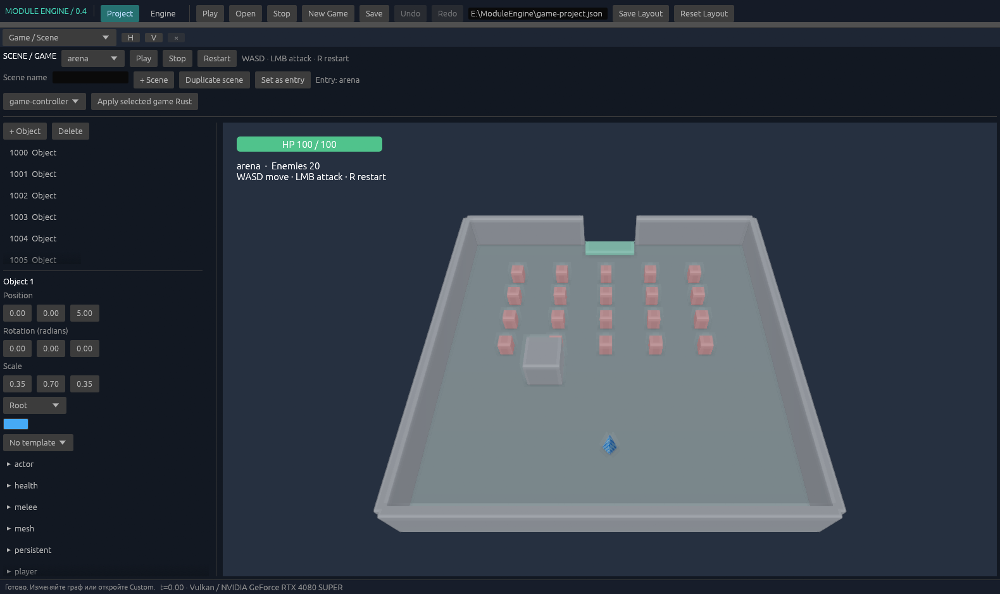
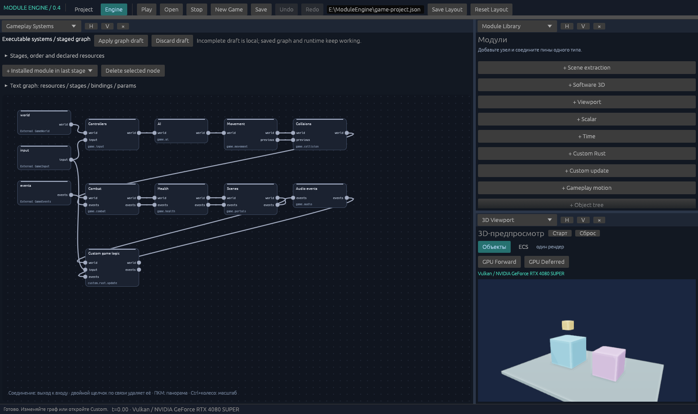
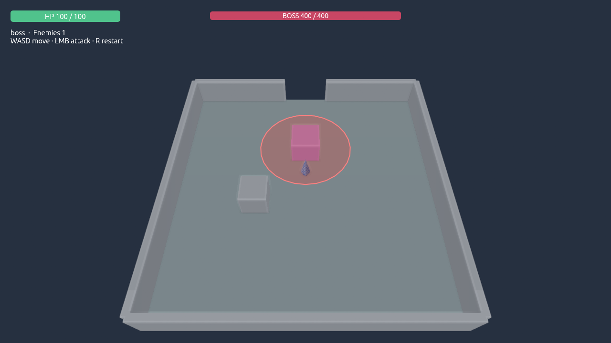

# Результат игрового этапа 0.4

Этап реализован в `E:\ModuleEngine`: авторские сцены и шаблоны, граф исполняемых систем, постоянное состояние Rust Custom, статический импорт и самостоятельный Windows Player. Прежний `project.json` оставлен для демонстрационного маршрута; новая игра находится в `game-project.json`.

## Что запускать

| Результат | Путь относительно корня проекта |
| --- | --- |
| Редактор 0.4 | `outputs/ModuleEngine.exe` |
| Игра без редакторских окон | `outputs/game-player-v04/Player.exe` |
| Полный редактируемый workspace | `outputs/source-project-v04` |
| Редактор для команды с выбранной архитектурой | `outputs/team-build-v04/ModuleEngine.exe` |
| Результаты проверки | `outputs/verification-v04` |

```powershell
.\outputs\ModuleEngine.exe
# Game / Scene → Play; редактирование авторской сцены после Stop.
.\outputs\game-player-v04\Player.exe
```

WASD — движение; ЛКМ — один удар к курсору, поражающий каждого врага в области один раз; R — перезапуск. После первой арены войдите в зелёный проход и победите босса. Его тяжёлая атака предварительно показывает красную область. E демонстрирует работу Rust Custom. Управление, экспорт и замеры подробно описаны в [Player](player.md).

## Почему появились эти части

Сцена теперь является сохраняемыми данными, а Play работает с её копией. Шаблоны распространяют общие изменения на экземпляры, сохраняя индивидуальные overrides. Компоненты подключённых модулей определяют обычные поля инспектора; архив неактивных компонентов сохраняется у автора и исключается из runtime/новых поставок.

Граф систем задаёт порядок и типизированные зависимости; реестр подключает реализации через фабрики. Object и ECS действительно используют разные хранилища. Экземпляр provider сохраняется между кадрами. Проверка мира проходит до публикации состояния систем/Custom; отказ откатывает кадр. Stop, переход сцены и закрытие вызывают lifecycle hooks. [Контракты и расширение](module-execution.md).

Rust Custom исполняется постоянным процессом с явно объявленным состоянием. Совместимое применение сохраняет состояние; несовместимое требует явного reset или миграции. Экспорт заранее собирает workers и GPU SPIR-V, чтобы игроку не нужны были компиляторы. [Состояние и ошибки](custom-state.md), [формат ресурсов](content.md).

## Проверки 14 октября 2026

Ниже сохранены результаты первоначальной поставки 0.4. Текущие сборки по тем же путям дополнены визуалом ближнего боя; его устройство, снимок и отдельные результаты проверки описаны в [combat-feedback](combat-feedback.md). Предыдущие сборки сохранены в `outputs/update-backup-v04-combat-*`, первоначальные отчёты — в `outputs/verification-v04`.

- **126 unit tests прошли**, включая реальные Rust-процессы, GPU, зависимые ресурсы, состояния, UI-ввод, сцены/шаблоны, упаковку и lifecycle.
- Workspace Clippy и генерация rustdoc прошли с `-D warnings`; форматирование проверено.
- Прежние CPU, Vulkan/Rust/source-export integration и настройки Project проверены отдельно.
- Object/ECS выполняют одинаковые 180 действий: совпадают мир, события, состояния и фактические Vulkan-пиксели с импортированной моделью.
- Автопилот прошёл две сцены: 20 монстров, переход, босс и победа. Тестовое здоровье повышено до 5000, остальная механика сохранена; это проверка прохождения, а не баланса. Смерть проверена отдельной сценой с 1 HP, затем Restart восстановил авторскую сцену.
- Player перенесён в отдельную папку. В проверке Rust/Cargo отсутствовали в PATH, `MODULE_ENGINE_DXC` указывал на отсутствующий файл; использовались готовые workers/SPIR-V. В пакете нет native Rust-исходников, SDK или компиляторов. Попытка вызвать команду редактора из Player отклонена.
- Полный экспорт подтвердил доступность Engine. Перенесённая Team-поставка скомпилировала Custom через собственный `.sdk` и проверила авторскую игру; Engine остался недоступен, принудительный `--profile full` отклонён. Использовались установленные Rust/MSVC и существующий кеш закреплённых сторонних зависимостей; новая установка инструментов не проверялась.

### Производительность

Референс: RTX 4080 SUPER, Windows, Vulkan + оконное представление egui/OpenGL, монитор 3440×1440 144 Hz. Фактические framebuffer и игровой canvas — **1920×1080**. Сцена и здоровье обычные; во всех 120 измеренных кадрах оставались 20 живых врагов и статус Playing. Перед измерением — 30 прогретых кадров.

| Измерение | Среднее | p95 | Максимум |
| --- | --- | --- | --- |
| GameHost: симуляция, Custom, звук, Vulkan/readback | 4,78 мс | 5,18 мс | 5,37 мс |
| Полный оконный цикл Player | 9,68 мс | 11,00 мс | 11,60 мс |

Оконный цикл: **103,35 FPS**, цель 60 FPS выполнена. Это callback start-to-start с обработкой, выводом, vsync и планированием ОС; время физического появления изображения на экране отдельно не измерялось. Окно было без фокуса, пользовательского ввода во время замера не было; игровые системы и противники продолжали работать. Размер, нагрузка и статус проверяются самим отчётом. Результат относится к этому ПК и фиксированному примеру.

Исходные данные: `outputs/verification-v04/player-native/native-frame-report.json`, `player-final-functional/game-report.json`; `release-evidence.json` содержит контрольные суммы executable и условия проверки. Полное описание методики — [game-verification.md](game-verification.md).

## Проверка интерфейса







Последний снимок использует отдельную авторскую fixture: старт во второй сцене и персонаж рядом с боссом. Для диагностического двухкадрового screenshot реально выполняется один fixed tick. Снимок проверяет видимость HUD/области атаки; это не доказательство прохождения игры. Поставляемый проект не изменён этой fixture.

## Что остаётся дальше

Это работающий небольшой движок и игровой пример. Пока нет скелетной анимации, полного PBR/прозрачности, динамической физики/navmesh, микшера и пространственного звука, сохранения прогресса после выхода, бесшовного streaming и Linux. Аудио сейчас одноголосное PCM WAV. GPU кадр всё ещё возвращается на CPU; нативный swapchain и несколько кадров в полёте — следующий путь масштабирования.

Визуальный Rust поддерживает ограниченное подмножество, а остальной код хранит текстом. Native-модули требуют пересборки. Player использует тот же host executable в игровом режиме: физическое исключение редакторского кода из бинарника отдельно не выполнено. Свежая установка Windows/инструментов на другой машине не проверялась. Дальнейшие решения записаны в [questions.md](questions.md).
