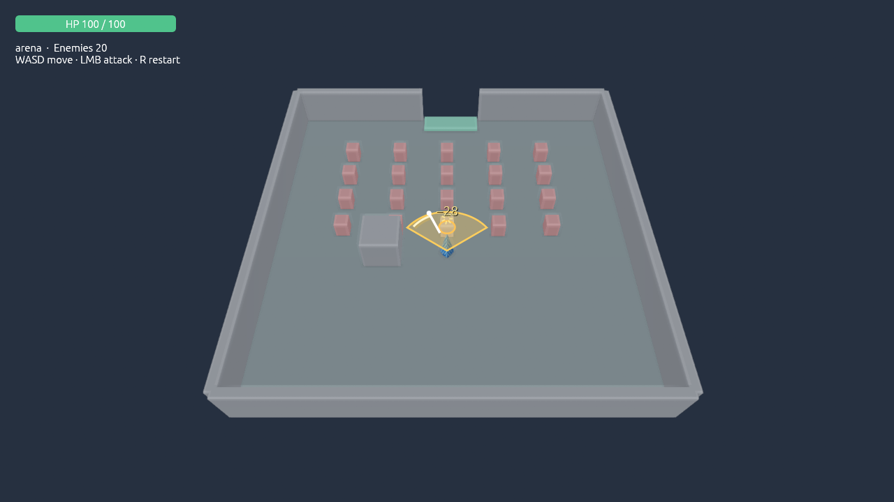

# Визуальная обратная связь ближнего боя

[English](../combat-feedback.md) | [Русский](combat-feedback.md) | [Документация](README.md)

В игровом примере урон уже рассчитывался, но обычный удар не показывал область и результат. Эта правка добавляет общий визуал для редакторского Play и самостоятельного Windows Player, сохраняя правила боя и авторские сцены.

## Что видно в игре

- До удара бледно-голубой сектор и стрелка показывают направление под курсором. Золотые кольца выделяют живых противников, которые сейчас подходят под проверку попадания.
- Во время удара область становится золотой и появляется движущийся след взмаха. Направление фиксируется в начале удара, включая настраиваемую подготовку; текущая мышь снова управляет предпросмотром после его завершения.
- Подтверждённое попадание высветляет модель на 0,16 секунды, создаёт искры и всплывающее число урона. Искры и число сохраняются 0,35 секунды, включая смертельные попадания после удаления цели.
- Атаки врагов и полученный игроком урон обозначаются красным.

Радиус, угол, урон, перезарядка и попадание один раз по каждой цели за взмах не изменены. В поставляемом примере это дальность 2,2, угол 1,9 радиана, урон 28 и длительность взмаха 0,12 секунды. Предпросмотр проверяет текущую геометрию, а не готовность перезарядки. Радиус цели учитывается в дальности, угол проверяется по её центру: цель может быть доступна у самого края нарисованного сектора.

## Где это устроено

| Часть | Назначение |
| --- | --- |
| `crates/gameplay-arpg/src/queries.rs` | `MeleeArea::contains` — общая проверка области для боя и подсветки; `melee_aim`/`melee_targets` — запросы предпросмотра; `attack_visuals`/`hit_visuals` — временные данные настоящих ударов и попаданий. |
| `crates/gameplay-arpg/src/ui/combat_visuals.rs` | Общая проекция секторов, целей, следов, искр и чисел; вспышка в извлечённом снимке сцены. |
| `crates/editor/src/player.rs` | Игровой HUD вызывает общий визуал; самостоятельный Player показывает те же эффекты. |
| `crates/editor/src/game_ui.rs` | Передаёт прицеливание активного редакторского игрового окна. |
| `crates/game-host/src/game_host.rs` | Применяет вспышки после материалов к снимку для GPU, сохраняя исходные цвета и компоненты объектов. |

Временные данные живут по игровым часам: Pause замораживает эффект, Stop/Restart/загрузка сцены очищают его. Victory/Defeat скрывают боевые наложения. Секторы и следы проецируются поверх изображения сцены; анимация скелета и частицы с проверкой глубины сюда не входят.

Описание управления — в [Player](player.md), контракт боя — в [gameplay](gameplay.md).

## Проверка этой правки

14 октября 2026 прошли 136 workspace unit tests, проверка форматирования, Clippy для всех targets и генерация rustdoc с `-D warnings`. Новые проверки покрывают границы сектора, цели без здоровья, одинаковые результаты Object/ECS, направление при движении курсора во время взмаха и подготовки, смертельное попадание, истечение эффектов и сохранность авторских цветов/материалов.

Окончательный экспортированный Player проверен без Rust/Cargo в PATH и с заведомо отсутствующим DXC: использует готовые workers и SPIR-V. Сравнение Object/ECS, отказ/откат Custom, смерть/Restart и прохождение двух арен прошли. Как и прежде, автопрохождение использует отдельную копию с повышенным здоровьем; поставляемая игра от этого не меняется.

Отдельный замер настоящего окна Player на RTX 4080 SUPER: 1920×1080, 20 живых врагов, 30 прогретых и 120 измеренных кадров. Средний период кадра — 11,13 мс (89,83 FPS), p95 — 13,47 мс; ошибок нет, цель 60 FPS выполнена. Замер выполнен с обычной сценой, без пользовательского ввода и без фокуса окна. Он не является отдельным стресс-тестом большого количества одновременно рисуемых ударов. Первоначальные показатели 0.4 сохранены отдельно в [release-v04](release-v04.md).

Снимок получен собственным screenshot-режимом native Player. Отдельная авторская fixture ставит персонажа в 1,4 единицы от монстра; до открытия окна исполняются три настоящих fixed tick, первый с действием атаки. Урон, дальность и угол остаются обычными. Эффекты взяты из состояния боя; изображение не дорисовывалось. Fixture не заменяет `game-project.json`.

Отчёты и точный вход снимка находятся в `outputs/combat-feedback-verification`: `player-final-functional/game-report.json`, `player-final-native/native-frame-report.json`, `capture-project.json`, `capture-fixture.json`, `release-evidence.json`. Обновлены `outputs/ModuleEngine.exe`, `outputs/game-player-v04`, `outputs/source-project-v04` и `outputs/team-build-v04`. Резервная папка предыдущих сборок записана в `backup-path.txt` рядом с отчётами.
